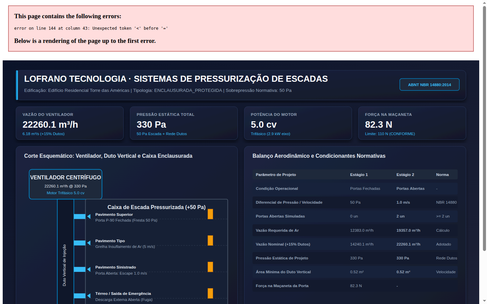
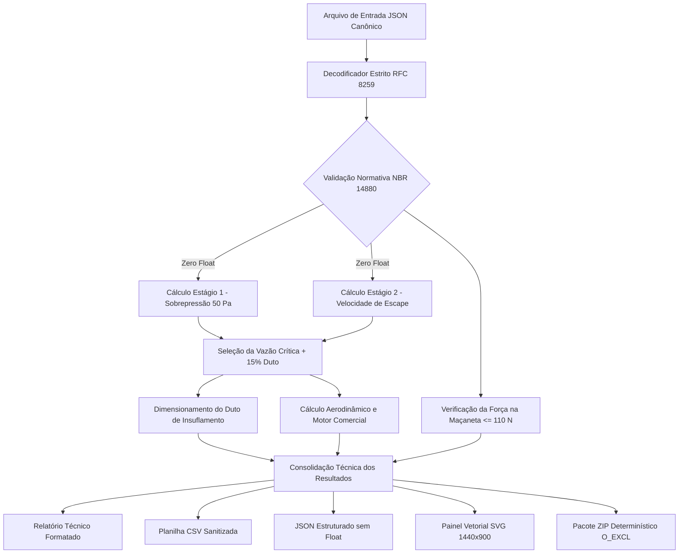

# Dimensionamento de Sistemas de Pressurização de Escadas de Segurança (ABNT NBR 14880:2014)

[](https://github.com/martinlofranodeoliveira/dimensionamento-pressurizacao-escadas-nbr14880/actions/workflows/ci.yml)
[](https://www.python.org/)
[](https://www.abnt.org.br/)
[-success.svg)]()
[-brightgreen.svg)]()
[](LICENSE)

Sistema computacional de alta precisão para projeto, cálculo e dimensionamento aerodinâmico de sistemas de pressurização de escadas de emergência em edifícios comerciais, residenciais e hospitalares, em estrita conformidade com os critérios e equacionamentos da norma brasileira **ABNT NBR 14880:2014** (*Saídas de emergência em edifícios — Sistemas de pressurização de escadas*).

Desenvolvido segundo as diretrizes de engenharia de software da **LOFRANO TECNOLOGIA**: 100% em português brasileiro, dependência zero de pacotes externos (utilizando exclusivamente a biblioteca padrão do Python), aritmética racional exata via `fractions.Fraction` (proibição total de ponto flutuante IEEE-754 em cálculos de vazão, pressão, força e potência eletromecânica) e empacotamento determinístico.

---

## Painel Esquemático de Engenharia

O módulo inclui gerador vetorial SVG integrado e renderização gráfica em alta resolução (1440x900) contendo o corte esquemático do edifício, conjunto moto-ventilador centrífugo, duto vertical de ar, grelhas de insuflamento e diagrama de forças nas portas corta-fogo:



---

## Fundamentação Normativa e Física (ABNT NBR 14880:2014)

A norma ABNT NBR 14880:2014 estabelece dois estágios simultâneos e fundamentais que regem a capacidade do sistema:

### 1. Estágio 1 — Portas Fechadas (Garantia de Sobrepressão)
Objetiva manter um gradiente de pressão positiva entre o corpo da escada enclausurada e as áreas comuns dos pavimentos adjacentes, impedindo a penetração de fumaça e gases tóxicos pelas frestas perimetrais das portas corta-fogo:

$$\Delta P_{\text{min}} = 50\text{ Pa}$$

A vazão volumétrica de vazamento pelas frestas é regida pela equação do orifício:

$$Q_1 = 0{,}827 \cdot A_F \cdot (\Delta P)^{1/2}$$

Para o diferencial regulamentar de $50\text{ Pa}$:

$$Q_1 = 0{,}827 \cdot A_F \cdot \sqrt{50} \approx 5{,}85 \cdot A_F \quad [\text{m}^3/\text{s}]$$

Onde $A_F$ é o somatório das áreas de frestas perimetrais:
- Porta Simples ($0{,}90\text{ m} \times 2{,}10\text{ m}$): $A_{F,\text{simples}} = 0{,}021\text{ m}^2$
- Porta Dupla ($1{,}80\text{ m} \times 2{,}10\text{ m}$): $A_{F,\text{dupla}} = 0{,}035\text{ m}^2$

### 2. Estágio 2 — Portas Abertas (Velocidade de Escape de Ar)
Garante uma velocidade média de ar através das portas abertas durante a evacuação dos ocupantes, repelindo ativamente os gases quentes do incêndio para fora da rota de fuga:

- **Com sistema de sprinklers / chuveiros automáticos**: $v_{\text{escape}} \ge 1{,}00\text{ m/s}$
- **Rota crítica sem sprinklers e escada direta**: $v_{\text{escape}} \ge 2{,}00\text{ m/s}$

Número regulamentar de portas abertas simultâneas no cálculo:
- Edificações até 10 pavimentos ou altura $\le 30\text{ m}$: no mínimo 1 porta aberta.
- Edificações com mais de 10 pavimentos ou altura $> 30\text{ m}$: no mínimo 2 portas abertas simultâneas.

Vazão do Estágio 2:

$$Q_2 = (N_{\text{abertas}} \cdot A_{\text{porta}} \cdot v_{\text{escape}}) + Q_{\text{residual,fechadas}}$$

### 3. Seleção do Ventilador e Majoração de Rede de Dutos
A vazão do ventilador centrífugo adota o maior valor entre $Q_1$ e $Q_2$, acrescido obrigatoriamente da margem normativa de $15\%$ ($23/20$) para perdas por estanqueidade ao longo do duto:

$$Q_{\text{projeto}} = \max(Q_1, Q_2) \cdot 1{,}15$$

A pressão estática total do ventilador é dada pela soma do diferencial da escada e a perda de carga do circuito de distribuição:

$$P_{\text{total}} = 50\text{ Pa} + \Delta P_{\text{distribuição}}$$

A potência no eixo do ventilador e a potência do motor trifásico comercial (adicionando $15\%$ de reserva) são calculadas sem float:

$$P_{\text{eixo}} = \frac{Q_{\text{projeto}} \cdot P_{\text{total}}}{\eta_{\text{ventilador}}} \quad [\text{W}]$$

$$P_{\text{motor}} = \frac{P_{\text{eixo}} \cdot 1{,}15}{735{,}5} \quad [\text{cv}]$$

### 4. Limite de Força de Abertura da Porta Corta-Fogo (Item 5.1.3)
Para assegurar a evacuação humana segura por pessoas com capacidade física reduzida, a força total exercida na maçaneta (a $0{,}075\text{ m}$ da borda oposta às dobradiças) não pode exceder $110\text{ N}$:

$$F_{\text{total}} = F_{\text{mola}} + \frac{A_{\text{porta}} \cdot \Delta P}{2} \le 110{,}0\text{ N}$$

Onde $F_{\text{mola}} \approx 35\text{ N}$ representa a resistência do dispositivo mecânico de fechamento automático.

---

## Fluxo Lógico e Arquitetura do Sistema



---

## Estrutura do Repositório

```
dimensionamento-pressurizacao-escadas-nbr14880/
├── .github/
│   └── workflows/
│       └── ci.yml                     # Pipeline CI multiplataforma (Linux 3.11-3.14, Windows 3.14)
├── docs/
│   ├── exemplo.png                    # Renderização gráfica do painel (1440x900)
│   └── painel_exemplo.svg             # Esquema vetorial da instalação
├── examples/
│   ├── edificio_corporativo_escritorios.json # 16 pavimentos, 56m, duto metálico
│   ├── edificio_residencial_torre_alta.json  # 28 pavimentos, 84m, 2 portas abertas
│   └── hospital_centro_cirurgico.json        # 8 pavimentos, 32m, rota crítica sem sprinklers
├── scripts/
│   ├── check_distribution.py         # Validador estrito de artefatos sdist e wheel
│   └── generate_assets.py            # Script headless de geração de imagens
├── src/
│   └── pressurizacao_nbr14880/
│       ├── __init__.py                # Exportações principais do módulo
│       ├── calculator.py              # Motor de cálculo em frações exatas
│       ├── cli.py                     # Interface de linha de comando pt-BR
│       ├── codecs.py                  # Parser e serializador JSON RFC 8259
│       ├── constants.py               # Constantes e coeficientes da NBR 14880
│       ├── exporters.py               # Exportadores TXT, CSV sanitizado e ZIP determinístico
│       ├── models.py                  # Modelos imutáveis com validações prévias
│       ├── py.typed                   # Marcação de conformidade PEP 561
│       └── svg_generator.py           # Gerador procedural de esquemas vetoriais
├── tests/
│   ├── test_calculator.py             # Testes do motor aerodinâmico e potências
│   ├── test_casos_avancados.py        # Casos de borda, dutos de alvenaria e conformidade
│   ├── test_cli.py                    # Testes de subcomandos e parâmetros da CLI
│   ├── test_codecs.py                 # Testes de rejeição de float, BOM e chaves duplicadas
│   ├── test_constants.py              # Testes das constantes físicas da NBR 14880
│   ├── test_exporters.py              # Testes de formatação, sanitização e integridade
│   ├── test_models.py                 # Testes de dataclasses e tipos enumerados
│   └── test_svg.py                    # Testes de integridade da saída gráfica SVG
├── tools/
│   └── verify_independent.py          # Auditor independente em SQLite em memória
├── LICENSE                            # Licença de Código Aberto MIT
├── pyproject.toml                     # Metadados de empacotamento PEP 517/621
└── README.md                          # Manual de engenharia e referência técnica
```

---

## Instalação e Execução

### Requisitos
- Python 3.11 ou superior (testado até Python 3.14).
- Nenhuma dependência externa necessária para execução de cálculos ou geração de relatórios.

### Instalação em Modo Editável
```bash
git clone https://github.com/martinlofranodeoliveira/dimensionamento-pressurizacao-escadas-nbr14880.git
cd dimensionamento-pressurizacao-escadas-nbr14880
pip install -e .
```

### Linha de Comando (CLI)

O pacote disponibiliza o ponto de entrada `pressurizacao-nbr14880`:

```bash
# Exibir ajuda detalhada
pressurizacao-nbr14880 --ajuda

# Executar cálculo exibindo memorial técnico descritivo
pressurizacao-nbr14880 calcular examples/edificio_residencial_torre_alta.json

# Exportar resultado em formato JSON canônico estruturado
pressurizacao-nbr14880 calcular examples/edificio_residencial_torre_alta.json --formato json

# Exportar planilha CSV sanitizada
pressurizacao-nbr14880 calcular examples/edificio_residencial_torre_alta.json --formato csv

# Gerar pacote completo determinístico ZIP contendo memorial, CSV, JSON e painel SVG
pressurizacao-nbr14880 calcular examples/edificio_residencial_torre_alta.json --pacote-zip dist/pacote_pressurizacao.zip

# Gerar arquivo de modelo JSON para preenchimento
pressurizacao-nbr14880 gerar-exemplo --saida novo_projeto.json

# Listar catálogo normativo de referências da NBR 14880
pressurizacao-nbr14880 catalogo
```

---

## Formato do Arquivo de Entrada (JSON)

Exemplo de entrada para edifício residencial alto com 28 pavimentos (`examples/edificio_residencial_torre_alta.json`):

```json
{
  "nome_edificio": "Edifício Residencial Torre Alta",
  "quantidade_pavimentos": 28,
  "altura_total_m": "84.0",
  "tipo_escada": "enclausurada_protegida",
  "tipo_duto": "metalico_galvanizado",
  "possui_sprinklers": true,
  "quantidade_portas_simples": 28,
  "quantidade_portas_duplas": 0,
  "portas_abertas_projeto": 2,
  "perda_carga_distribuicao_pa": 280
}
```

> **Atenção**: Números não-inteiros devem ser expressos entre aspas como strings decimais exatas (ex: `"84.0"`) para evitar contaminação por imprecisão binária de ponto flutuante IEEE-754.

---

## Verificação e Auditoria Independente

O projeto conta com uma ferramenta de auditoria independente (`tools/verify_independent.py`) que utiliza um banco de dados relacional `sqlite3` puramente em memória para reexecutar e auditar os cálculos sem importar os módulos de produção da biblioteca, garantindo blindagem contra vícios de implementação.

Para executar os testes e o auditor independente:

```bash
# Executar a suíte de 53 testes unitários nativos
PYTHONPATH=src python3 -m unittest discover -s tests -p "test_*.py" -v

# Executar o auditor independente em SQLite
python3 tools/verify_independent.py
```

---

## Licença

Distribuído sob a licença de código aberto MIT. Consulte o arquivo [LICENSE](LICENSE) para obter todos os termos e condições.

**Lofrano Tecnologia** — Engenharia de Software e Projetos Contra Incêndio de Alta Precisão (2026).
